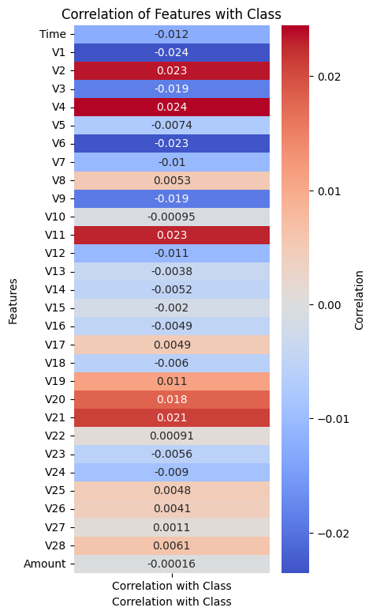
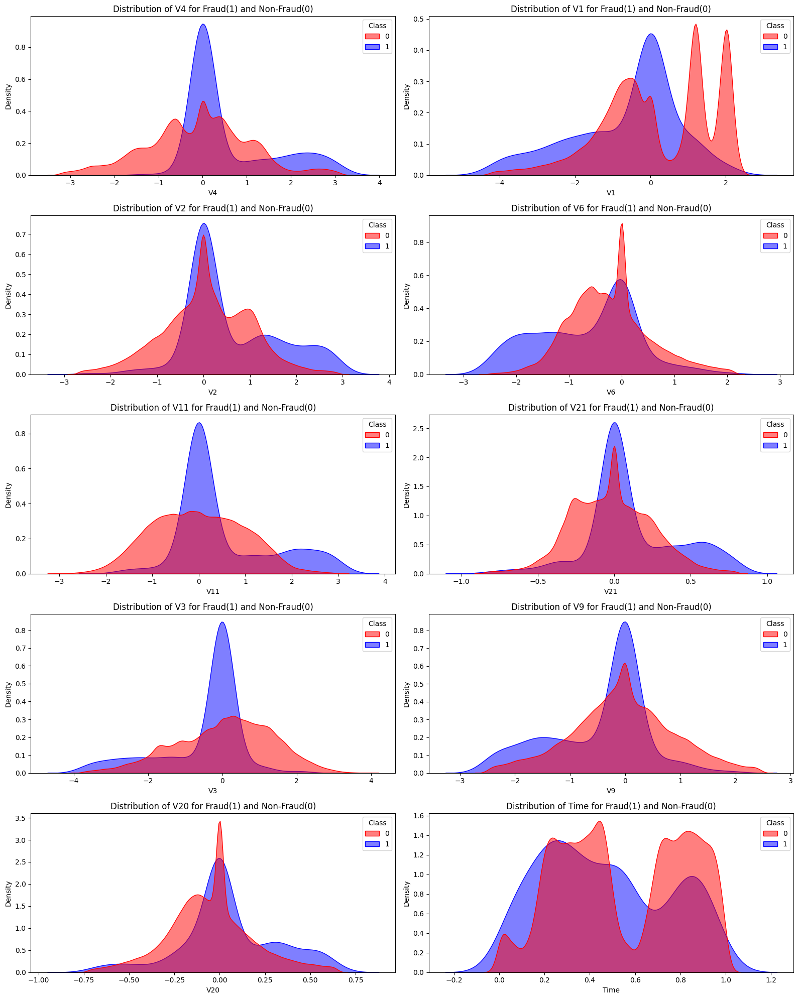
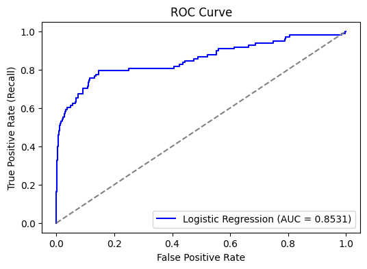

# Credit Card Fraud Model Comparison

**Author:** Mohammed Adeen Shaik  
**Review date:** 11 October 2026

## Research question

Why can very high accuracy coexist with poor fraud detection?

## Data and provenance

Historical saved coursework outputs using the Worldline and ULB credit-card dataset.

Source materials are linked from the repository README. Input fingerprints are recorded in [the evidence manifest](evidence.json) so a reader can identify the exact committed artifacts used in this review.

## Method and analytical rationale

The original notebook compares logistic regression, KNN and SVM using a stratified split and reports precision, recall, F1 and ROC AUC. The newer src/train.py offers a separate training-only preprocessing and validation-threshold workflow.

## Findings and interpretation

Historical saved coursework results, **not a fresh rerun** and **not results of src/train.py**. Logistic regression reported 99.8402% accuracy but only 9.1837% fraud recall. KNN reported 48.9796% recall and 58.8957% F1; SVM reported 95.4545% precision but 21.4286% recall. KNN captured more positives in this recorded experiment, but preprocessing leakage limits any generalization claim.

| Model | Precision | Recall | F1 |
|---|---:|---:|---:|
| Logistic regression | 0.818182 | 0.091837 | 0.165138 |
| KNN | 0.738462 | 0.489796 | 0.588957 |
| SVM | 0.954545 | 0.214286 | 0.350000 |

## Limitations

Historical notebook preprocessing was fitted before splitting, including outlier replacement and scaling. Cross-validation scaling was also performed before folding. Historical scores therefore have leakage risk and are not results of the newer pipeline. Rare fraud may be an informative outlier rather than an error.

## Reproduction

Use the setup commands and input contract in the [repository README](https://github.com/Adeen1607/Logistic-Regression#readme). Open the [notebook catalogue](notebooks.html) for annotated code and saved outputs. Keep raw records and model binaries local; public reports contain aggregate results or source-embedded figures.

## Final visual results

*Figure from Mohammed Adeen Shaik_8969152_Midterm.ipynb, original code cell 42.*

*Figure from Mohammed Adeen Shaik_8969152_Midterm.ipynb, original code cell 45.*

*Figure from Mohammed Adeen Shaik_8969152_Midterm.ipynb, original code cell 76.*

